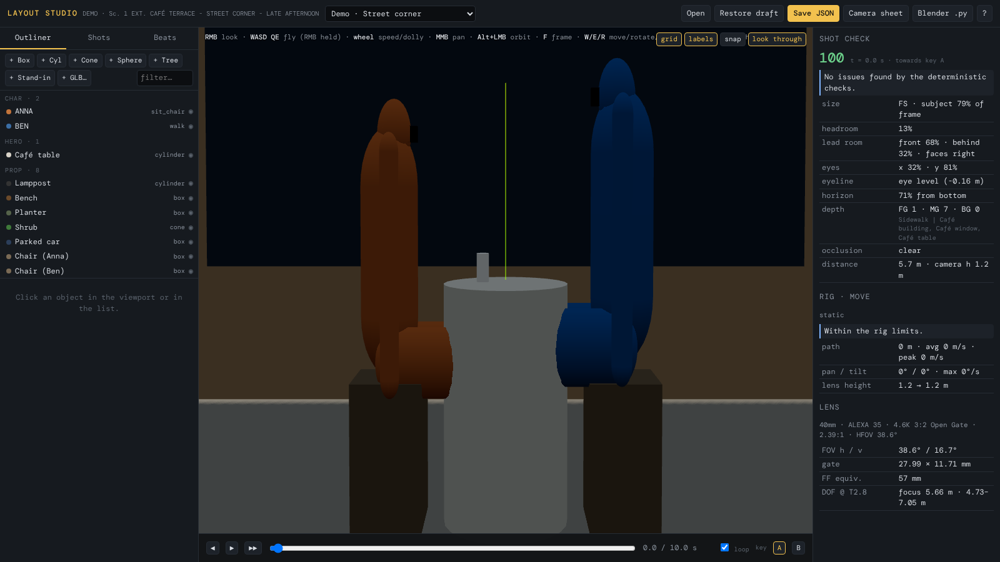

# Layout Studio

Previz layout tool for film: blockout proxies, posed stand-ins, **real lenses and real camera rigs**, a deterministic
**shot check** (size, headroom, lead room, depth layers, occlusion, horizon, 180° line, rig limits) and exports for the
crew (camera sheet) and for Blender (animated cameras).

It is built so that an agent (Claude) can write the layout — the scene file is plain JSON and every camera can be
described as a *framing definition* ("CU of Arthur from 30°, eye level, 65 mm") that the deterministic core turns into
coordinates — while you fly through the scene with Unreal-style controls and fix things by hand.

No build step. Open `index.html` through any static server (or GitHub Pages). three.js loads from `vendor/three/` when that folder is present (self-contained, offline) and from jsDelivr otherwise.





```
python3 -m http.server 8000      # then http://localhost:8000/layout_studio/
```

## Layout of the tool

| Path | What |
|---|---|
| `index.html`, `app/` | the viewer (three.js): viewport, outliner, shots, beats, PiP camera view, shot check, exports |
| `core/` | dependency-free ES modules shared by browser and Node: `lens.js` (filmbacks, FOV, DOF), `rigs.js` (rig constraints → `pose(t)`), `motion.js` (easing), `standin.js` (poses, keypoints, body parts), `framing.js` (single / two-shot / OTS / insert solvers), `metrics.js` (shot check), `keys.js` (framing definitions → keys), `exporters.js` (camera sheet, Blender script), `schema.js` |
| `scenes/_lib/build.mjs` | scene builder used by generation scripts: `node scenes/demo/build.mjs` |
| `scenes/demo/` | public demo scene (fictional café terrace) |
| `scenes/<project>/` | your productions. `scenes/timeless/` is git-ignored on purpose (story material stays private) |
| `tests/core.test.mjs` | `node --test tests/core.test.mjs` |
| `tests/smoke.mjs` | headless Playwright run: loads a scene, walks the shots, screenshots, fails on JS errors |

## Controls (Unreal style)

* **RMB** drag: look. With RMB held: **W A S D** fly, **Q / E** down / up, **Shift** faster, **wheel** changes fly speed.
* **wheel** (RMB not held): dolly forward / back. **MMB** drag: pan. **Alt + LMB**: orbit the focus point.
* **LMB**: select object or shot camera. **W / E / R**: move / rotate / scale gizmo. **F**: frame. **Del**: delete.
* **Space** play, **[ ]** previous / next shot, **L** look through the shot camera, **G** grid, **H** labels, **Ctrl+Z** undo, **Ctrl+S** download JSON.
* While looking through the camera, RMB + WASD drive the **shot camera**; releasing writes the active key (A or B).

Stand-ins are posed **per beat**: with a shot or beat selected, moving a stand-in edits that beat's blocking. A shot whose
`beatA` and `beatB` differ interpolates the blocking during the move (characters walk from one mark to the other).

## Scene file (`layout-studio/scene`, v1)

Metres, Y up, X east, Z south (three.js convention; the Blender export converts to Z up).

```jsonc
{
  "format": "layout-studio/scene", "version": 1, "project": "DEMO",
  "scene": { "number": 1, "heading": "EXT. ... - DAY", "int_ext": "EXT", "location": "...", "time": "DAY", "pages": "1", "synopsis": "..." },
  "world":  { "ground": { "size": 200, "color": "#6d6a63" }, "sky": "#c9d6e3", "sun": { "azimuth": 240, "elevation": 22 }, "fog": 0.0009 },
  "objects": [
    { "id": "PROP_table", "name": "Café table", "role": "HERO", "kind": "cylinder", "position": [0, 0.15, 0.2], "rotation": [0, 0, 0], "scale": [1, 1, 1], "size": [0.8, 0.74, 0.8], "color": "#d8d3c8", "source": "inferred" },
    { "id": "CHAR_anna", "name": "ANNA", "role": "CHAR", "kind": "standin", "position": [-0.75, 0.15, 0.2], "rotation": [0, 90, 0], "height": 1.68, "pose": "sit_chair", "color": "#c2743b" }
  ],
  "beats": [ { "id": "b1", "label": "Anna waits", "t0": 0, "t1": 10, "blocking": { "CHAR_anna": { "position": [-0.75, 0.15, 0.2], "facing": 90, "pose": "sit_chair" } } } ],
  "shots": [ {
    "id": "sh010", "name": "1A", "beat": "b1", "beatA": null, "beatB": null, "size": "WS", "subject": "CHAR_anna", "intent": "...",
    "camera": { "filmback": "ALEXA35_OG", "focal_mm": 27, "aspect": 2.39, "squeeze": 1, "fstop": 2.8, "focus_m": 11 },
    "rig": { "type": "dolly" }, "duration_s": 8, "curve": "cinematic",
    "keys": { "A": { "position": [x, y, z], "target": [x, y, z], "roll": 0 }, "B": { ... } },
    "framing": { "A": { "type": "single", "azimuth": -40, "cameraHeight": 1.3, "distance": 11 }, "B": { ... } },
    "wantForeground": true, "allowOcclusion": false, "line": ["CHAR_anna", "CHAR_ben"], "notes": ""
  } ]
}
```

* `kind`: `box cylinder cone sphere capsule plane tree standin gltf`. `position` is the pivot at the **base** of the object. `tree` size = canopy diameter, height, trunk fraction. `gltf` loads `url` (e.g. a GLB exported from a reconstruction) and measures its own size.
* `source`: `script | observed | inferred | reference` — what the geometry is based on (a one-image reconstruction must mark what it invented).
* `standin` poses: `stand walk sit_ground sit_chair crouch kneel lie_prone lie_supine`; keypoints and body parts come from `core/standin.js` and are shared by the viewer and the metrics.
* Shot `size`: `EWS WS FS MLS MS MCU CU BCU ECU INSERT`. Rigs: `static slider dolly crane steadicam handheld gimbal drone vehicle` (each with speed / height / reach limits that produce warnings). Curves: `linear easeIn easeOut easeInOut smooth smoother cinematic quickStart holdMoveHold`.
* Keys hold position + look-at target (+ roll). `framing` keeps the *description* that produced them, so **Re-solve** can recompute the keys after you change the lens, the size or the blocking. Framing types: `single` (subject, azimuth, elevation | cameraHeight, leadRoom, headroom, distance), `two` (a, b, side ±1, margin), `ots` (fg, bg, side, fitSize picks the focal from the kit), `object` (object, fill, azimuth, elevation), `raw`.
* `line`: the two characters that define the 180° axis for this shot; consecutive shots of the same beat that declare the same axis are checked for crossings.

## Shot check

Deterministic, no AI: measured size (from body keypoints or, for lying subjects, head size), headroom, lead room, eyes on
the thirds, horizon height, dutch angle, depth layers (objects in FG / MG / BG relative to the subject distance), occlusion
of the subject (ray tests against every other object), eyeline height, wide-lens distortion risk, rig limits (speed, track,
boom range, crane reach, pan rate) and the 180° line. Each shot gets a 0–100 score; the intent is "first pass that a human
then nudges", not taste.

## Exports

* **Camera sheet** (`.md`): per shot — lens, filmback, FOV, rig and move (length, speeds, pan/tilt, lens heights, crane pivot/arm), key positions, distances, warnings.
* **Blender script** (`.py`): rebuilds proxies and stand-ins in collections, one camera per shot with the real gate and focal, animation baked at 24 fps from the rig solver (including handheld / Steadicam texture), timeline markers that switch cameras. Run it from Blender's Scripting tab; from Blender, export USD / FBX to Unreal.
* **JSON**: the scene itself (also autosaved in the browser).

## Workflow for a new scene

1. Describe the location, props and characters in a build script (see `scenes/demo/build.mjs`) or draw them in the viewer with the + buttons; mark what is observed vs inferred.
2. Add beats (blocking states) and shots with framing definitions; `node scenes/<project>/build.mjs` prints the shot check report.
3. Open the viewer, walk the shots, look through the lens, nudge objects or keys, re-solve, export.
4. When a reference image for the location exists, reconstruct it (e.g. Higgsfield 3D Jutsu → GLB) and drop the GLB into the scene as a `gltf` object; keep the proxies for what the photo does not show.

## Status

v0.1 — Phase 0 (viewer + deterministic core) and the first scene-layout script. Next: the agent loop that writes build
scripts from the screenplay and iterates on the shot check, USD/FBX camera export, Unreal bridge, stand-in animation clips.
