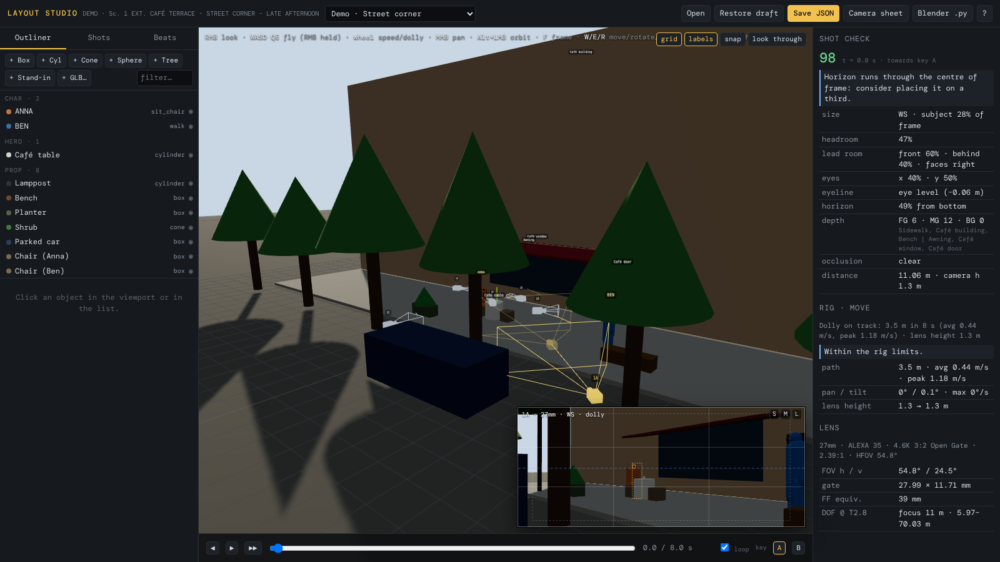

# Layout Studio

Previz layout tool for film: blockout proxies, posed stand-ins, **real lenses and real camera rigs**, a deterministic
**shot check** (size, headroom, lead room, depth layers, occlusion, horizon, 180° line, rig limits) and exports for the
crew (camera sheet) and for Blender (animated cameras).

It is built so that an agent (Claude) can write the layout — the scene file is plain JSON and every camera can be
described as a *framing definition* ("CU of Arthur from 30°, eye level, 65 mm") that the deterministic core turns into
coordinates — while you fly through the scene with Unreal-style controls and fix things by hand.

No build step. Open `index.html` through any static server (or GitHub Pages). three.js loads from `vendor/three/` when that folder is present (self-contained, offline) and from jsDelivr otherwise.




```
python3 -m http.server 8000      # then http://localhost:8000/layout_studio/
```

## Layout of the tool

| Path | What |
|---|---|
| `index.html`, `app/` | the viewer (three.js): five workflow steps, viewport, PiP camera view, shot check, exports. `export_mp4.js` in-browser MP4 export, `audio.js` dialogue playback and mix, `tooltip.js` + `tips.js` hover help |
| `core/` | dependency-free ES modules shared by browser and Node: `lens.js` (filmbacks, FOV, DOF), `rigs.js` (rig constraints → `pose(t)`), `motion.js` (easing), `standin.js` (mannequin skeleton, poses, keypoints, body parts), `blocking.js` (blocking over time), `shot.js` (shot solving with subject tracking), `framing.js` (single / two-shot / OTS / insert solvers), `metrics.js` (shot check), `keys.js` (framing definitions → keys), `exporters.js` (camera sheet, Blender script), `schema.js` |
| `scenes/_lib/build.mjs` | scene builder used by generation scripts: `node scenes/demo/build.mjs` |
| `scenes/demo/` | public demo scenes: a fictional café terrace and the mannequin pose library |
| `scenes/timeless/` | TIMELESS, scene by scene: `sc001.build.mjs` (Scene 1 layout script), `sc001.json`, its camera sheet and Blender script. The whole-film breakdown (`index.json`) stays local |
| `vendor/` | three.js 0.170 and mp4-muxer 5.2 (MIT), copied unmodified so the viewer works offline |
| `tests/core.test.mjs` | `node --test tests/core.test.mjs` |
| `tests/smoke.mjs` | headless Playwright run: loads a scene, walks the shots, screenshots, fails on JS errors |
| `tools/render_mp4.mjs` | offline sequence render to MP4, dialogue included (see below) |
| `tools/mix_dialogue.mjs` | lays the recorded dialogue onto a rendered video, on the same frame plan |

## Workflow: five steps

The left panel follows the order of the work. Each step has a one-line how-to under the step bar, and every control
explains itself when the cursor rests on it for half a second.

1. **Set**: the location. Proxies at real size, props, trees, stand-ins, GLB models.
2. **Blocking**: the story beats and each actor's mark in every beat (position, facing, pose, acting). The viewport
   shows tape marks on the floor: a ring where the actor stands, an arrow for the facing, a dashed line for the move
   between beats, the selected beat in bold (**M** toggles them).
3. **Camera**: shots, lens, rig, keys A and B (labelled in the viewport), timing curve; the shot check grades the frame.
4. **Sound**: dialogue per shot, the voice cast, where each line sits in the shot, a play button per take.
5. **Review**: every shot with its score and voices, real-time screening of the edit, exports.

## Controls (Unreal style)

* **RMB** drag: look. With RMB held: **W A S D** fly, **Q / E** down / up, **Shift** faster, **wheel** changes fly speed.
* **wheel** (RMB not held): dolly forward / back. **MMB** drag: pan. **Alt + LMB**: orbit the focus point.
* **LMB**: select object or shot camera. **W / E / R**: move / rotate / scale gizmo. **F**: frame. **Del**: delete.
* **Space** play, **[ ]** previous / next shot, **L** look through the shot camera (letterboxed to the lens aspect, with live subtitles), **G** grid, **H** labels, **M** actor marks, **Ctrl+Z** undo, **Ctrl+S** download JSON.
* While looking through the camera, RMB + WASD drive the **shot camera**; releasing writes the active key (A or B).
* Shot panel: lens, rig, follow, shake intensity, duration, timing curve with a bezier editor, keys A and B (set from the view, aim at the subject, re-solve from the framing definition).
* Stand-in panel: blocking per beat (position, facing, pose) and **acting**: head, neck, spine, arms and legs joint angles on top of the pose, with a reset to the library pose.

Stand-ins are posed **per beat**: with a shot or beat selected, moving a stand-in edits that beat's blocking. A shot whose
`beatA` and `beatB` differ plays the transition: a character that changes mark gets up, moves to the new mark facing the
travel direction (a slide, no walk cycle) and settles into the new pose; a character that stays on its mark blends poses.

## Stand-ins (Unreal-style mannequins)

`core/standin.js` builds every stand-in from a skeleton with real proportions: adult tables from standard anthropometry,
a 6-year-old table (bigger head, shorter legs), ages in between blended. Set `age` on the stand-in, or leave it empty and
it is estimated from the height for children. Poses are joint angles with forward kinematics and automatic grounding, so the
same body drives the viewer meshes, the shot-check keypoints, occlusion and the Blender export.

* Library poses: `stand walk sit_ground sit_cross sit_chair crouch kneel lie_prone lie_supine` (see `scenes/demo/mannequin_poses.json`).
* Acting per beat: a blocking pose can be `{ "base": "sit_ground", "head": { "pitch": 25 }, "elbow": { "flex": 120 } }`.
  Joints: `root spine chest neck head` (pitch, yaw, roll) and `shoulder elbow wrist hip knee ankle`, both sides or `L` / `R`
  (flex, abd, twist). Pitch positive bends forward, yaw positive turns to the character's left.
* Blends `{ "a": "sit_ground", "b": "stand", "w": 0.4 }` are produced by the blocking transitions and can be used directly.

## Following a moving subject

`rig.follow: true` makes a Steadicam / handheld / gimbal / dolly camera follow its subject through the blocking: the
camera keeps the offsets of keys A and B relative to the subject, swings around it instead of crossing it, and booms up and
down less than the actor (`followVertical`, default 0.7). `rig.aim: "subject"` keeps the camera where it is and pans with
the subject (sticks, crane). The shot check evaluates the middle of every move as well as both keys.

## Scene file (`layout-studio/scene`, v1)

Metres, Y up, X east, Z south (three.js convention; the Blender export converts to Z up).

```jsonc
{
  "format": "layout-studio/scene", "version": 1, "project": "DEMO",
  "scene": { "number": 1, "heading": "EXT. ... - DAY", "int_ext": "EXT", "location": "...", "time": "DAY", "pages": "1", "synopsis": "..." },
  "world":  { "ground": { "size": 200, "color": "#6d6a63" }, "sky": "#c9d6e3", "sun": { "azimuth": 240, "elevation": 22 }, "fog": 0.0009 },
  "objects": [
    { "id": "PROP_table", "name": "Café table", "role": "HERO", "kind": "cylinder", "position": [0, 0.15, 0.2], "rotation": [0, 0, 0], "scale": [1, 1, 1], "size": [0.8, 0.74, 0.8], "color": "#d8d3c8", "source": "inferred" },
    { "id": "CHAR_anna", "name": "ANNA", "role": "CHAR", "kind": "standin", "position": [-0.75, 0.15, 0.2], "rotation": [0, 90, 0], "height": 1.68, "pose": "sit_chair", "color": "#c2743b" }
  ],
  "beats": [ { "id": "b1", "label": "Anna waits", "t0": 0, "t1": 10, "blocking": { "CHAR_anna": { "position": [-0.75, 0.15, 0.2], "facing": 90, "pose": "sit_chair" } } } ],
  "shots": [ {
    "id": "sh010", "name": "1A", "beat": "b1", "beatA": null, "beatB": null, "size": "WS", "subject": "CHAR_anna", "intent": "...",
    "camera": { "filmback": "ALEXA35_OG", "focal_mm": 27, "aspect": 2.39, "squeeze": 1, "fstop": 2.8, "focus_m": 11 },
    "rig": { "type": "dolly" }, "duration_s": 8, "curve": "cinematic",
    "keys": { "A": { "position": [x, y, z], "target": [x, y, z], "roll": 0 }, "B": { ... } },
    "framing": { "A": { "type": "single", "azimuth": -40, "cameraHeight": 1.3, "distance": 11 }, "B": { ... } },
    "wantForeground": true, "allowOcclusion": false, "line": ["CHAR_anna", "CHAR_ben"], "notes": ""
  } ]
}
```

* `kind`: `box cylinder cone sphere capsule plane tree standin gltf`. `position` is the pivot at the **base** of the object. `tree` size = canopy diameter, height, trunk fraction. `gltf` loads `url` (e.g. a GLB exported from a reconstruction) and measures its own size.
* `source`: `script | observed | inferred | reference` — what the geometry is based on (a one-image reconstruction must mark what it invented).
* `standin` poses: `stand walk sit_ground sit_chair crouch kneel lie_prone lie_supine`; keypoints and body parts come from `core/standin.js` and are shared by the viewer and the metrics.
* Shot `size`: `EWS WS FS MLS MS MCU CU BCU ECU INSERT`. Rigs: `static slider dolly crane steadicam handheld gimbal drone vehicle` (each with speed / height / reach limits that produce warnings). Curves: `linear easeIn easeOut easeInOut smooth smoother cinematic quickStart holdMoveHold`.
* Keys hold position + look-at target (+ roll). `framing` keeps the *description* that produced them, so **Re-solve** can recompute the keys after you change the lens, the size or the blocking. Framing types: `single` (subject, azimuth, elevation | cameraHeight, leadRoom, headroom, distance), `two` (a, b, side ±1, margin), `ots` (fg, bg, side, fitSize picks the focal from the kit), `object` (object, fill, azimuth, elevation), `raw`.
* `line`: the two characters that define the 180° axis for this shot; consecutive shots of the same beat that declare the same axis are checked for crossings.
* `dialogue`: `[{ "who": "CLAIRE", "line": "Sabato. Perché?", "audio": "audio/sc001/….mp3", "dur_s": 2.19, "at": 0.4 }]`. `audio` and
  `dur_s` come from the recorded take (see Dialogue voices), `at` optionally fixes the start inside the shot. Subtitles,
  playback and exports all use the same timing. The scene's `cast` maps each character to its voice.
* `curve`: a preset name or a cubic bezier `[x1, y1, x2, y2]` (CSS convention: time on x, progress on y). `easeInOutCubic` is a slow start and a slow landing; heavy S-curves raise the peak speed, which the rig check reports.
* `rig.shake`: operator shake intensity for handheld / Steadicam / gimbal / drone (1 = default, 0 = locked); longer lenses are operated steadier automatically. `rig.follow`, `rig.followVertical`, `rig.aim`: see "Following a moving subject".

## Shot check

Deterministic, no AI: measured size (first body landmark under the bottom edge reading from the head down, or head size for
lying subjects), headroom, lead room, eyes on the thirds, horizon height, dutch angle, depth layers (objects in FG / MG / BG
relative to the subject distance), occlusion of the subject (exact ray tests against boxes, cones, cylinders, ellipsoids and
the mannequins' capsules), near objects filling the frame, camera inside an object, eyeline height, wide-lens distortion
risk, rig limits (speed, track, boom range, crane reach, pan rate) and the 180° line. `wantForeground` can be set per key
in the framing definition (a push-in that passes its foreground). Each shot gets a 0–100 score; the intent is "first pass that a human
then nudges", not taste.

## Dialogue voices (Higgsfield)

Dialogue lines live in the shots (`{ who, line, at? }`). Claude voices them from the chat with Higgsfield text-to-speech
(ElevenLabs engine), one voice per character, and saves the takes next to the scene:
`scenes/<project>/audio/<scene>/*.mp3` plus `voices.json` (cast, and which take belongs to which line). The build script
attaches them with `B.voices(...)`; a take is used only while its text still matches the line, so an edited line never
plays a stale take. Each line gets a start and length inside its shot (from the take, or estimated from the text without
one), and that one timeline drives the subtitles, the live playback, Export MP4 and the offline render. A line that runs
past the cut is flagged. To change a voice or a delivery, ask Claude (for example "voice scene 1 again, Arthur deeper").

## Previs of the edit (real-time playback and MP4)

* **Real time, in the viewer.** **▶ all** in the timeline switches to the lens view and plays every shot back to back on your GPU,
  letterboxed to the lens aspect, with the stand-ins moving between their beat marks and the dialogue as subtitles. **L** goes
  back to the world view.
* **Export MP4** (top bar, or step 5) renders the same sequence frame by frame on your GPU and encodes it in the browser with
  WebCodecs (H.264 where the browser has it, else VP9 or AV1), with the dialogue track (AAC, else Opus), then downloads the file.
  Options: all shots or the current one, 1280 to 3840 wide, supersampling 1 to 2×, 24/25/30 fps, burn-in (shot, lens, rig,
  timecode, action text, subtitles), dialogue on or off. Nothing is uploaded. Recent Chrome, Edge, Safari or Firefox.
* **Offline, headless:** `node tools/render_mp4.mjs scenes/<project>/<scene>.json out.mp4 [--fps 24] [--width 1920] [--height 804] [--ss 1.5] [--fast] [--shots 1A,1B]`
  renders the same frames in headless Chromium, encodes H.264 with `ffmpeg` and lays the dialogue on (AAC; `--no-audio` to skip).
  Use it on a machine with a GPU, or for automation.
  Without a GPU Chromium falls back to a CPU renderer (SwiftShader) at about 1 to 3 frames per second; `--fast` (Lambert shading,
  lighter shadows, no logarithmic depth) and `--width 1280 --height 536 --ss 1.5` keep previews quick. Split long scenes with
  `--shots` across processes (with `--no-audio`), join the parts with `ffmpeg -f concat -c copy`, then add the voices with
  `node tools/mix_dialogue.mjs <scene.json> joined.mp4 final.mp4`.
* `--ss` / supersampling renders more pixels and filters them down, so thin edges do not crawl during moves.
* Shadows are fitted to the area where the action is (4096 map, 2048 in fast mode), so they stay sharp and stable.

## Exports

* **Camera sheet** (`.md`): per shot — lens, filmback, FOV, rig and move (length, speeds, pan/tilt, lens heights, crane pivot/arm), key positions, distances, warnings.
* **Blender script** (`.py`): rebuilds proxies and stand-ins in collections, one camera per shot with the real gate and focal, animation baked at 24 fps from the rig solver (including handheld / Steadicam texture), timeline markers that switch cameras. Run it from Blender's Scripting tab; from Blender, export USD / FBX to Unreal.
* **JSON**: the scene itself (also autosaved in the browser).

## Workflow for a new scene

1. Describe the location, props and characters in a build script (see `scenes/demo/build.mjs`) or draw them in the viewer with the + buttons; mark what is observed vs inferred.
2. Add beats (blocking states) and shots with framing definitions; `node scenes/<project>/build.mjs` prints the shot check report.
3. Open the viewer, walk the shots, look through the lens, nudge objects or keys, re-solve, play the edit in real time, export.
4. When a reference image for the location exists, reconstruct it (e.g. Higgsfield 3D Jutsu → GLB) and drop the GLB into the scene as a `gltf` object; keep the proxies for what the photo does not show.

## Status

v0.2 — viewer + deterministic core, Unreal-style mannequins with acting, subject following, real-time screening of the edit,
in-browser MP4 export, and TIMELESS Scene 1. Next: the agent loop that writes build scripts from the screenplay and iterates
on the shot check, more TIMELESS scenes, USD/FBX camera export, Unreal bridge, stand-in animation clips.
